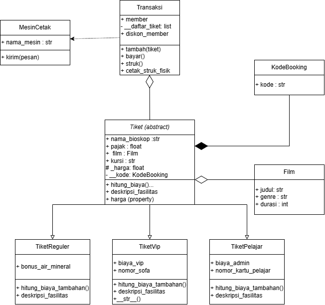
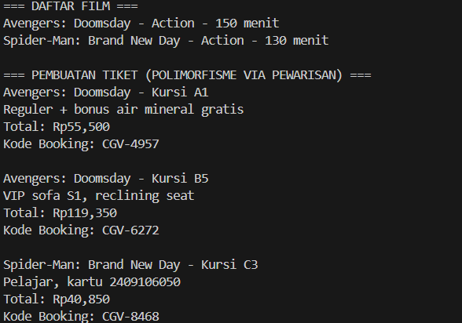
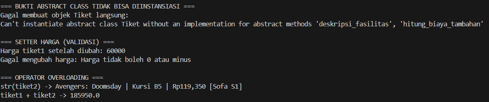
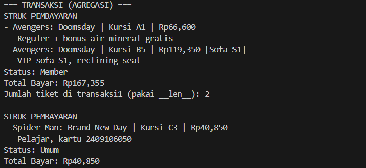
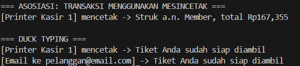

# Sistem Pemesanan Tiket Bioskop CGV

## Tentang Program

Posttest ini mengguanakan tema sistem pemesanan tiket bioskop CGV, dibuat dengan Python menggunakan pendekatan Pemrograman Berorientasi Objek (PBO). Tema film yang dipakai adalah film-film Marvel seperti Avengers dan Spider-Man, dipilih karena sesuai dengan minat pribadi, dan tema ini sudah mendapat persetujuan dari aslab kelas.

Program ini terdiri dari tiga class yang saling berhubungan lewat objek, yaitu `Film`, `Tiket`, dan `Transaksi`. Ketiganya belum menggunakan pewarisan (inheritance) karena materi tersebut memang belum dipelajari, jadi rencananya akan ditambahkan sedikit-sedikit di posttest-posttest berikutnya. Fokus utama di tahap ini ada pada penerapan class, object, atribut, method, dan encapsulation sesuai tiga modul awal yang sudah dipelajari.

Alur programnya kurang lebih begini: objek film dibuat lebih dulu dari class `Film`, lalu dipakai untuk membuat objek tiket dari class `Tiket`, dan pada akhirnya tiket-tiket tersebut dikumpulkan ke dalam objek `Transaksi` untuk dihitung totalnya sekaligus dicetak struknya.

## Yang Dikerjakan

### 1. Membuat Class Film

Class `Film` dibuat untuk menyimpan data film yang akan ditonton. Bagian ini masih tergolong sederhana, hanya berisi atribut instance dan satu method saja, karena fungsinya memang sebatas menyimpan data.

- Atribut instance: `judul`, `genre`, `durasi`. Ketiganya diisi lewat `__init__()` menggunakan `self`, sehingga tiap objek film bisa punya nilai yang berbeda-beda.
- Method: `tampilkan()`, instance method yang dipakai untuk mencetak info film (judul, genre, durasi) ke layar.

### 2. Membuat Class Tiket

Class `Tiket` merepresentasikan satu tiket yang dipesan, dan dibuat berelasi dengan objek Film — jadi tiap tiket otomatis membawa objek film di dalamnya.

- Atribut kelas: `nama_bioskop` (isinya "CGV") dan `pajak` (isinya 0.11, untuk PPN 11%). Keduanya dijadikan atribut kelas karena nilainya sama untuk semua tiket, tidak perlu beda-beda tiap objek.
- Atribut instance: `film`, `jenis`, `kursi`, dan `__harga`. Khusus `__harga` dibuat private (dua underscore) karena harga dianggap sebagai data penting yang sebaiknya tidak bisa diubah sembarangan dari luar class.
- Decorator `@property` diterapkan pada `harga` sebagai getter, sehingga nilainya tetap bisa dibaca dari luar tapi melalui jalur yang terkontrol. Setter-nya (`@harga.setter`) dilengkapi validasi: kalau harga baru yang dimasukkan bernilai 0 atau minus, perubahan itu ditolak dan program mencetak pesan peringatan.
- Method instance: `total_harga()` untuk menghitung harga tiket setelah ditambah pajak, dan `cetak()` untuk menampilkan detail tiket (judul film, jenis, kursi, harga, total setelah pajak).
- Static method: `cek_jenis()`, dipakai untuk mengecek apakah jenis tiket yang dimasukkan termasuk yang tersedia (reguler, 3d, vip). Dijadikan static method karena fungsi ini tidak membutuhkan data dari objek maupun class-nya, cukup mengecek input saja.

### 3. Membuat Class Transaksi

Class `Transaksi` menangani proses pembelian, di mana satu transaksi bisa berisi lebih dari satu tiket sekaligus.

- Atribut kelas: `diskon_member` (isinya 0.1, diskon 10% untuk pelanggan member).
- Atribut instance: `member` (status apakah pembeli member atau bukan) dan `__list_tiket` (daftar tiket yang dibeli dalam transaksi tersebut). `__list_tiket` dibuat private karena daftar ini idealnya hanya bisa diubah lewat method yang sudah disediakan, bukan diubah langsung dari luar.
- Method instance: `tambah()` untuk memasukkan objek tiket ke dalam `__list_tiket`, `bayar()` untuk menjumlahkan total harga semua tiket dan otomatis mengurangi diskon kalau pembelinya member, serta `struk()` untuk mencetak ringkasan seluruh transaksi (daftar tiket, status member, total bayar).
- Class method: `atur_diskon()`, menggunakan `@classmethod` supaya method ini bisa mengubah nilai `diskon_member` dan perubahannya langsung berlaku untuk semua objek Transaksi yang ada, bukan cuma satu objek saja.

### 4. Menerapkan Encapsulation

Dua atribut dibuat private dalam program ini, yaitu `__harga` di class Tiket dan `__list_tiket` di class Transaksi. Keduanya dianggap sebagai data penting, sehingga tidak seharusnya bisa diubah sembarangan langsung dari luar class tanpa melalui validasi.

Untuk `__harga`, getter dan setter dibuat memakai decorator `@property` dan `@harga.setter`, dengan validasi di dalam setter-nya: kalau ada percobaan mengisi harga dengan angka 0 atau minus, program akan menolak perubahan tersebut dan mencetak pesan peringatan, bukan langsung mengubah nilainya begitu saja.

### 5. Melakukan Pengujian Program

Bagian akhir program (main program) berisi beberapa pengujian, di antaranya:

- Dua objek film (Avengers: Doomsday dan Spider-Man: Brand New Day) dibuat untuk menguji class `Film` dan method `tampilkan()`.
- Dua objek tiket dengan jenis dan harga berbeda dibuat untuk menguji class `Tiket`, sekaligus mencoba method `cetak()` dan `total_harga()`.
- Static method `cek_jenis()` diuji dengan dua input, satu valid ("vip") dan satu tidak valid ("gold"), untuk membuktikan fungsi ini bekerja sesuai harapan.
- Setter `harga` diuji dengan dua kondisi: mengisi angka valid (90000) yang seharusnya diterima, dan mengisi angka minus (-5000) yang seharusnya ditolak. Dari pengujian ini terbukti validasi yang dibuat benar-benar berjalan.
- Dua objek transaksi dibuat, satu untuk pembeli member dan satu untuk pembeli umum, lalu method `tambah()`, `bayar()`, dan `struk()` diuji di masing-masing objek untuk memastikan perhitungan diskon berjalan sesuai status membernya.
- Class method `atur_diskon()` turut diuji dengan mengubah diskon member dari 10% menjadi 20%, kemudian struk dicetak ulang untuk membuktikan perubahan itu berlaku ke seluruh objek Transaksi.

## Posttest 2 — Relasi UML dan Inheritance

Posttest ketiga ini melanjutkan tema yang sama, sistem pemesanan tiket bioskop CGV, dengan fokus menerapkan relasi UML (asosiasi, agregasi, komposisi) dan konsep inheritance sesuai modul yang sudah diajarkan.

### Relasi UML yang Diterapkan

**Asosiasi** diterapkan antara `Transaksi` dan `MesinCetak`, lewat method `cetak_struk_fisik()`. Objek `MesinCetak` diterima sebagai parameter dan dipakai sesaat saja untuk mencetak struk, tidak disimpan sebagai atribut tetap di dalam Transaksi, sehingga relasinya longgar dan kedua objek tetap independen satu sama lain.

**Agregasi** diterapkan di dua tempat. Pertama, antara `Transaksi` dan `Tiket`, di mana objek tiket dibuat di luar lalu didaftarkan ke transaksi lewat method `tambah()`. Kalau objek Transaksi dihapus, objek Tiket yang sudah dibuat tetap bisa berdiri sendiri. Kedua, antara `Tiket` dan `Film`, di mana objek Film dibuat dari luar lalu disimpan sebagai atribut tetap di dalam Tiket.

**Komposisi** diterapkan antara `Tiket` dan `KodeBooking`. Objek `KodeBooking` dibuat langsung di dalam konstruktor Tiket (bukan dikirim dari luar), dan disimpan sebagai atribut private. Karena sifatnya begitu, KodeBooking tidak punya arti kalau berdiri sendiri tanpa tiketnya, dan akan ikut musnah kalau objek Tiket dihapus.

### Inheritance yang Diterapkan

Superclass yang dibuat adalah `Tiket`, dengan dua subclass yaitu `TiketReguler` dan `TiketVip`.

Kedua subclass memanggil konstruktor superclass lewat `super().__init__(film, kursi, harga)`, supaya tidak perlu menulis ulang logika pengisian atribut dasar seperti film, kursi, dan harga.

Masing-masing subclass punya atribut tambahan yang unik: `TiketReguler` punya `bonus_air_mineral`, sedangkan `TiketVip` punya `nomor_sofa` dan `biaya_vip`. Atribut-atribut ini tidak dimiliki oleh superclass maupun subclass lainnya.

Method overriding diterapkan pada `cetak()` di kedua subclass (menambahkan info khusus setelah memanggil `super().cetak()`), dan pada `total_harga()` di `TiketVip` (menambahkan biaya layanan VIP di atas perhitungan dasar milik superclass).

Untuk tingkat akses, atribut `_harga` di superclass Tiket dibuat protected, supaya subclass (lewat method yang di-override seperti `total_harga()`) masih bisa mengakses dan memanfaatkannya. Sementara itu, atribut `__kode` (objek KodeBooking) dibuat private, karena memang hanya dipakai di dalam superclass Tiket sendiri, tidak perlu dan tidak boleh diakses langsung dari subclass maupun luar class.

## Posttest 3 — Abstraksi dan Polimorfisme

Posttest ini masih melanjutkan tema yang sama, sistem pemesanan tiket bioskop CGV, dengan fokus menerapkan abstraksi lewat abstract class, polimorfisme, serta relasi UML yang digambar dalam bentuk Class Diagram.

### Class Diagram

**Asosiasi — Transaksi ke MesinCetak.** Objek `MesinCetak` diterima lewat parameter method `cetak_struk_fisik(mesin)`, dipakai sesaat untuk mencetak, lalu tidak disimpan sebagai atribut tetap. Relasinya longgar karena kedua objek tetap bisa berdiri sendiri satu sama lain.

**Agregasi — Tiket ke Film.** Objek `Film` dibuat di luar lalu disimpan sebagai atribut tetap di `Tiket` lewat konstruktor. Dipilih agregasi (bukan komposisi) karena satu objek Film bisa dipakai oleh banyak tiket berbeda, dan Film tetap ada meskipun objek Tiket-nya dihapus.

**Agregasi — Transaksi ke Tiket.** Objek `Tiket` dibuat di luar lebih dulu, baru didaftarkan ke `Transaksi` lewat method `tambah()`. Tiket yang sudah dibuat tetap bisa berdiri sendiri walau transaksinya dihapus, jadi relasinya agregasi.

**Komposisi — Tiket ke KodeBooking.** Objek `KodeBooking` dibuat langsung di dalam konstruktor `Tiket` (bukan dikirim dari luar) dan disimpan sebagai atribut private. KodeBooking tidak punya arti berdiri sendiri tanpa tiketnya, dan ikut musnah kalau objek Tiket dihapus. Ini yang membedakannya dari agregasi.

### Penerapan Abstraksi

Abstract class dibuat pada `Tiket(ABC)` dengan dua abstract method: `hitung_biaya_tambahan()` dan `deskripsi_fasilitas()`. Ketiga subclass (`TiketReguler`, `TiketVip`, `TiketPelajar`) wajib mengimplementasikan keduanya dengan caranya masing-masing. Method konkret `total_harga()` dan `info_tiket()` dipakai bersama oleh semua subclass tanpa ditulis ulang.

### Penerapan Polimorfisme

**Polimorfisme via pewarisan.** Method `hitung_biaya_tambahan()` dan `deskripsi_fasilitas()` di-override berbeda oleh `TiketReguler`, `TiketVip`, dan `TiketPelajar`, lalu dipanggil lewat satu loop yang berisi objek dari ketiga subclass tersebut.

**Duck typing.** Class `MesinCetak` dan `NotifikasiEmail` tidak berhubungan lewat pewarisan, tapi keduanya punya method `kirim()`. Fungsi `kirim_notifikasi(media, pesan)` bisa memanggil keduanya tanpa tahu class aslinya.

**Operator overloading.** Magic method `__str__` dan `__add__` diterapkan di class `Tiket` (serta `__str__` di-override di `TiketVip`), dan `__len__` di class `Transaksi`.

### Nilai Plus: Prinsip SOLID (Opsional)

Program ini menerapkan **Open/Closed Principle (OCP)** lewat subclass `TiketPelajar`. Class `Tiket` terbuka untuk ekstensi (jenis tiket baru bisa ditambah lewat subclass baru), tapi tertutup untuk modifikasi karena class `Tiket` dan `Transaksi` tidak perlu diubah sama sekali saat `TiketPelajar` ditambahkan.

### Screenshot Output

**1. Daftar film dan pembuatan tiket (polimorfisme via pewarisan).** Tiga objek dari subclass berbeda dipanggil lewat satu loop, dan method yang sama menghasilkan fasilitas serta total harga yang berbeda.

**2. Bukti abstract class tidak bisa diinstansiasi, setter harga, dan operator overloading.** Percobaan membuat objek `Tiket` langsung menghasilkan `TypeError`. Setter menerima harga valid (60000) dan menolak harga minus (-5000). `__str__` dan `__add__` menampilkan dan menjumlahkan tiket.

**3. Transaksi (agregasi).** Tiket yang dibuat di luar didaftarkan ke transaksi lewat `tambah()`. Harga tiket A1 di struk (Rp66,600) berbeda dari saat dibuat (Rp55,500) karena harganya sudah diubah menjadi 60000 pada pengujian setter. Transaksi pertama mendapat diskon member 10%, transaksi kedua tidak. Fungsi `len()` memakai `__len__` milik `Transaksi`.

**4. Asosiasi dan duck typing.** `MesinCetak` dikirim lewat parameter `cetak_struk_fisik()` dan tidak disimpan di `Transaksi`. Dua class tanpa hubungan pewarisan dipanggil lewat fungsi `kirim_notifikasi()` yang sama.

